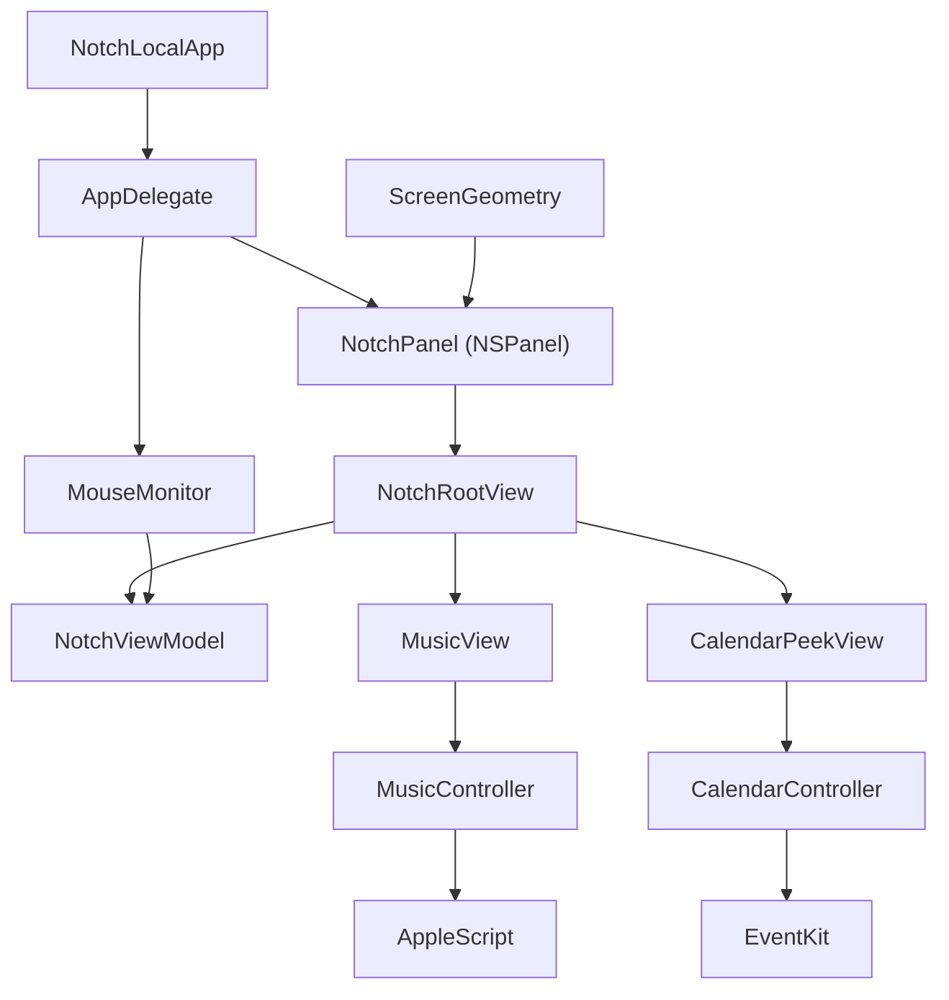

# 00 - Overview

## What we are building

NotchLocal is a menu bar app that draws a black panel exactly over the MacBook notch. When the pointer hovers the notch, the panel expands downward and shows:

1. Music controls for Spotify or Apple Music (artwork, title, artist, previous / play-pause / next)
2. The next few calendar events

When the pointer leaves, the panel shrinks back into the notch and lets clicks pass through.

## MVP scope

In scope:

- Notch-aligned panel on the built-in display, fallback handle on displays without a notch
- Hover expand / collapse with animation
- Spotify + Apple Music controls via AppleScript
- Upcoming events via EventKit
- Menu bar icon with Restart / Quit

Out of scope (see `09-roadmap.md`): file tray, HUD replacement, live activities, AirDrop, clipboard history, generic "Now Playing" for browsers, launch at login, settings window.

## Key decisions

- **No Xcode.** Swift Package Manager builds the binary; `scripts/build-app.sh` wraps it into `NotchLocal.app` and ad-hoc signs it. A real bundle is required for permission prompts.
- **AppleScript for music.** Apple locked down the private MediaRemote framework in macOS 15.4, so v0 talks to Spotify and Music directly through their public scripting interfaces.
- **Accessory app.** `LSUIElement = true`: no Dock icon, no app switcher entry.

## Architecture



The panel window is always the size of the **expanded** frame but fully transparent. Only the black notch shape is drawn. While collapsed, `ignoresMouseEvents = true` so the window never blocks clicks. A global mouse monitor detects the pointer entering the notch, expands the view model, and turns mouse events back on.

## Final layout

```
notch-local/
  README.md  AGENTS.md  .gitignore  Makefile  Package.swift
  Resources/Info.plist
  scripts/build-app.sh
  docs/00..09
  Sources/NotchLocal/
    App/       NotchLocalApp.swift, AppDelegate.swift
    Notch/     ScreenGeometry.swift, NotchPanel.swift, NotchViewModel.swift,
               MouseMonitor.swift, NotchShape.swift, NotchRootView.swift
    Music/     MusicController.swift, MusicView.swift
    Calendar/  CalendarController.swift, CalendarPeekView.swift
```

## Step order

1. [01 - Environment setup](01-environment-setup.md)
2. [02 - Project scaffold](02-project-scaffold.md)
3. [03 - Notch window](03-notch-window.md)
4. [04 - Hover expand](04-hover-expand.md)
5. [05 - Music controls](05-music-controls.md)
6. [06 - Calendar peek](06-calendar-peek.md)
7. [07 - Menu bar and lifecycle](07-menu-bar-and-lifecycle.md)
8. [08 - Testing checklist](08-testing-checklist.md)
9. [09 - Roadmap](09-roadmap.md)

## Working with Cursor

- Open `notch-local` as its own workspace.
- Prompt one step at a time, e.g. "Implement docs/03-notch-window.md".
- After each step: `make run`, check **Done when**, commit.
