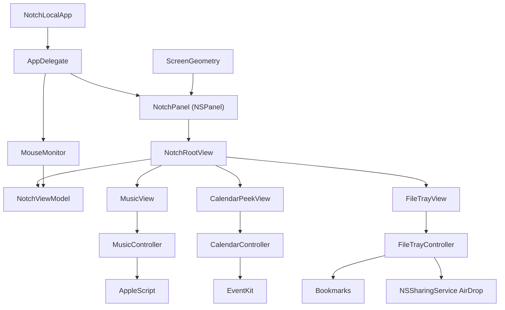

# 00 - Overview

## What we are building

NotchLocal is a menu bar app that draws a panel exactly over the MacBook notch. On macOS 26+ the expanded panel uses Liquid Glass; collapsed it stays opaque so it still covers the camera. When the pointer hovers the notch, the panel expands downward and shows:

1. Music controls for whatever macOS reports as Now Playing (Spotify, Apple Music, YouTube in a browser, Podcasts, …)
2. The next few calendar events (click to open)
3. Focus and battery
4. A compact file shelf (click to expand) and clipboard history
5. Volume / brightness peeks from the media keys

While collapsed, the notch can briefly widen for a live peek: a new track, a meeting in the next 5 minutes, or a battery warning.

When the pointer leaves, the panel shrinks back into the notch and lets clicks pass through.

## MVP scope

In scope:

- Notch-aligned panel on the built-in display, fallback handle on displays without a notch
- Hover expand / collapse with animation
- Any Now Playing source via `media-control`, with Spotify / Music AppleScript fallback
- Upcoming events via EventKit
- Collapsed live peeks (track change, meeting, battery)
- File tray with persistent bookmarks and AirDrop
- Clipboard shelf
- Focus and battery status
- Volume and brightness HUD peeks
- Settings and launch at login
- Menu bar icon with Settings / Restart / Quit

See `09-roadmap.md` for remaining ideas.

## Key decisions

- **No Xcode.** Swift Package Manager builds the binary; `scripts/build-app.sh` wraps it into `NotchLocal.app` and ad-hoc signs it. A real bundle is required for permission prompts.
- **AppleScript for music.** Apple locked down the private MediaRemote framework in macOS 15.4, so v0 talks to Spotify and Music directly through their public scripting interfaces.
- **Accessory app.** `LSUIElement = true`: no Dock icon, no app switcher entry.

## Architecture



The panel window is always the size of the **expanded** frame but fully transparent. Only the notch shape is drawn (Liquid Glass when expanded on macOS 26+, black otherwise). While collapsed, `ignoresMouseEvents = true` so the window never blocks clicks. A global mouse monitor detects the pointer entering the notch, expands the view model, and turns mouse events back on.

## Final layout

```
notch-local/
  README.md  AGENTS.md  .gitignore  Makefile  Package.swift
  Resources/Info.plist
  scripts/build-app.sh
  docs/00..17
  Sources/NotchLocal/
    App/       NotchLocalApp.swift, AppDelegate.swift
    Notch/     ScreenGeometry.swift, NotchPanel.swift, NotchViewModel.swift,
               MouseMonitor.swift, NotchShape.swift, NotchRootView.swift,
               GlassControlButton.swift, LivePeek.swift, PeekView.swift,
               LiveActivityController.swift
    Music/     MusicSource.swift, NowPlaying.swift, AppleScriptRunner.swift,
               MediaRemoteClient.swift, MusicController.swift, MusicView.swift
    Calendar/  CalendarController.swift, CalendarPeekView.swift
    Tray/      TrayItem.swift, ResolvedBookmark.swift, FileTrayStore.swift,
               FileTrayController.swift, FileDropView.swift, FileDragPasteboard.swift,
               AirDropService.swift, FileTrayView.swift
    Clipboard/ ClipboardItem.swift, ClipboardController.swift, ClipboardView.swift
    Status/    BatteryMonitor.swift, FocusMonitor.swift, StatusBarView.swift
    Settings/  SettingsStore.swift, SettingsView.swift, SettingsWindowController.swift
    HUD/       VolumeService.swift, BrightnessService.swift, MediaKeyMonitor.swift
```

## Step order

1. [01 - Environment setup](01-environment-setup.md)
2. [02 - Project scaffold](02-project-scaffold.md)
3. [03 - Notch window](03-notch-window.md)
4. [04 - Hover expand](04-hover-expand.md)
5. [05 - Music controls](05-music-controls.md)
6. [06 - Calendar peek](06-calendar-peek.md)
7. [07 - Menu bar and lifecycle](07-menu-bar-and-lifecycle.md)
8. [08 - Testing checklist](08-testing-checklist.md)
9. [09 - Roadmap](09-roadmap.md)
10. [10 - File tray and AirDrop](10-file-tray.md)
11. [11 - Generic Now Playing](11-generic-now-playing.md)
12. [12 - Live activity sneak peeks](12-live-activities.md)
13. [13 - Launch at login and settings](13-settings.md)
14. [14 - Clipboard shelf](14-clipboard.md)
15. [15 - Status row and calendar open](15-status-and-calendar.md)
16. [16 - Volume and brightness HUD](16-hud.md)
17. [17 - Distribution polish](17-distribution.md)

## Working with Cursor

- Open `notch-local` as its own workspace.
- Prompt one step at a time, e.g. "Implement docs/03-notch-window.md".
- After each step: `make run`, check **Done when**, commit.
